<div align="center">

<h1>
  <picture>
    <source media="(prefers-color-scheme: light)" srcset="assets/free-claude-code-wordmark-light.svg">
    
  </picture>
</h1>

[](https://github.com/Inkflow-Gab/claude-code-cli/blob/main/LICENSE)
[](https://www.python.org/downloads/)
[](https://github.com/astral-sh/uv)
[](https://github.com/Inkflow-Gab/claude-code-cli/actions/workflows/tests.yml)
[](https://pypi.org/project/ty/)
[](https://github.com/astral-sh/ruff)
[](https://github.com/Delgan/loguru)

[Start here](#quick-start) · [Computer install](docs/install-desktop.md) · [Phone setup](docs/install-mobile.md) · [Agents](docs/agents.md) · [Providers](docs/providers.md) · [Integrations](#optional-integrations) · [Help](#troubleshooting)

</div>

<p align="center">
  <em>Independent open-source project. Not affiliated with or endorsed by Anthropic. Claude and Claude Code are trademarks of Anthropic.</em>
</p>

> **Attribution:** This is a maintained copy of **Free Claude Code** by
> [Alishahryar1](https://github.com/Alishahryar1). The original project lives at
> [github.com/Alishahryar1/free-claude-code](https://github.com/Alishahryar1/free-claude-code),
> and its installer remains at
> `https://raw.githubusercontent.com/Alishahryar1/free-claude-code/main/scripts/install.sh`.
> See [Credits](#credits) below.

## Free Claude Code at a glance

Free Claude Code (FCC) runs a **local proxy** between coding agents and model
providers. Choose a coding agent, configure a provider you have access to, and
use the `fcc-*` launchers to route requests through FCC. Provider free tiers
and quotas are controlled by their operators; FCC does not grant free Claude
Code or Anthropic credits. You may need a provider API key or subscription.

- Run [Claude Code, Codex, Pi and other agents](docs/agents.md) with a shared
  model catalog. FCC also supports browser Code Sessions and client integrations.
- Choose among [hosted, subscription and local providers](docs/providers.md),
  with optional fallback models. Check each provider's current terms and limits.
- Code from an Ubuntu host or [control it from your phone](docs/install-mobile.md)
  using Telegram or Discord. The server and project files remain on the host.
- Optional voice notes, desktop integrations and RTK are documented below.

## Quick Start

**First choose where the agent runs.** FCC is installed on the computer that
contains your project files. A phone can control it with Telegram or Discord,
but an Android Termux/proot installation is not supported. Choose one guide:

| Goal | Guide |
| --- | --- |
| Install FCC and an agent on Ubuntu, macOS, Linux or Windows | **[Computer installation](docs/install-desktop.md)** |
| Control a computer's FCC from Android or iPhone | **[Phone setup](docs/install-mobile.md)** (install on the computer first) |

Each installation guide provides **one command per copyable block**, followed
by verification and troubleshooting. Free Claude Code is a local proxy, not a
source of Anthropic credits: set up a provider you have access to in local
Admin before expecting model responses.

<a id="install"></a>

### Ubuntu in brief

After installing Git and Make, [follow every step in the computer guide](docs/install-desktop.md#ubuntu-install).
From the repository directory the core commands are:

| Action | Command |
| --- | --- |
| Install prerequisites, FCC and Codex | `make setup AGENT=codex` |
| Verify installed commands | `make check AGENT=codex` |
| Start the local server (leave it running) | `make run` |
| Check the running server from a second terminal | `make check-online AGENT=codex` |
| Start the agent after configuring a provider | `fcc-codex` |

Change `codex` to the same agent name throughout if you choose another agent.
The full guide explains how to clone the repository, use curl instead of Make,
install on Windows, and safely access Admin from a headless computer. Do not
run the FCC installer as root. The server's Admin interface is loopback-only;
never open it to the public internet.

<a id="nvidia-nim-provider"></a>
<a id="3-configure-nvidia-nim"></a>

### Provider example: NVIDIA NIM

After starting the server, open the **local Admin URL** shown in its log.
Obtain a key from [NVIDIA NIM](https://build.nvidia.com/settings/api-keys),
enter `NVIDIA_NIM_API_KEY`, choose a tool-capable model in `MODEL`, then click
**Apply**. See [Choose a provider](docs/providers.md) for alternatives.
Never paste keys into commands or public issues. The local `/health` check only
confirms the server responds; it does not test a provider.

<a id="ubuntu-and-phone-setup"></a>

### Want to use a phone?

[Set up Telegram or Discord](docs/install-mobile.md) after installing FCC on
an Ubuntu/macOS/Windows host. The agent and project stay on the host; the
phone is only the remote control. The host must remain on and connected.

## Troubleshooting

- **Installation or missing command?** Follow the troubleshooting table in
  the [computer guide](docs/install-desktop.md#troubleshooting).
- **Bot not responding?** Follow the [mobile guide](docs/install-mobile.md#if-your-bot-does-not-reply).
- **Problem after installing?** Run `fcc-doctor` on the host and review the
  diagnostic report before sharing it. It may copy the report to your clipboard.

## Choose A Provider

Choose a provider you have access to, add its credentials in local Admin,
select a tool-capable model, and click **Apply**. Free-tier availability,
quotas, and pricing are controlled by each provider, not by FCC. See the
**[provider and model reference](docs/providers.md)** for the full catalog,
local models, fallback behavior, and reasoning controls.

<a id="connect-your-client"></a>

## Connect Your Client

For editor and app integrations, install the client, start FCC, then open
**Admin UI → Integrations** and click **Connect** on its card.

- **Claude Code in VS Code**: Install the [Claude Code extension](https://marketplace.visualstudio.com/items?itemName=anthropic.claude-code).
- **VS Code Chat**: Install the latest [VS Code](https://code.visualstudio.com/), connect, and select an FCC model in its built-in Chat model picker.
- **Claude Desktop**: Install [Claude Desktop](https://claude.ai/download). Fully quit it before connecting or disconnecting, then reopen it. Disconnect returns to normal Claude sign-in.
- **Codex in VS Code and App**: Install the [Codex extension](https://marketplace.visualstudio.com/items?itemName=openai.chatgpt) or Codex App.
- **Claude Code in JetBrains ACP**: Install Claude Agent in JetBrains AI Assistant and start it once, then click **Connect** in FCC. Reopen the IDE, select **Claude Code (FCC)**, and start a new chat. After JetBrains updates the agent, restart FCC before starting a new chat. Requires a local IDE in its standard installation locations.

Reload VS Code or restart the app/IDE after connecting. In Codex and Claude Desktop, select an FCC
model from the model picker. Reload or restart the client when FCC reports updated settings. Use
**Disconnect** on the same card to remove the integration.

Run FCC on the same computer and in the same user environment as the client you
are configuring.

<a id="optional-integrations"></a>

## Optional Integrations

For Telegram or Discord setup, allowed IDs/directories, and chat commands,
follow the **[mobile setup guide](docs/install-mobile.md)**. Configure these
integrations from local **Admin UI → Messaging**, then click **Apply**.

<details>
<summary><strong>Voice notes</strong></summary>

NVIDIA NIM transcription support is included in every installation. In **Admin UI → Messaging → Voice**, enable voice notes, select `nvidia_nim`, and choose a supported model. Configure your **NVIDIA NIM API key** on the Providers page.

For local Whisper on CPU or CUDA, stop FCC and re-run the installer (from
the clone, or replace `scripts/install.sh` with your downloaded
`fcc-install.sh`). Use the same agent you installed previously:

```bash
sh scripts/install.sh --agent codex --voice-local
```

For an NVIDIA GPU with CUDA 13.0:

```bash
sh scripts/install.sh --agent codex --voice-local --torch-backend cu130
```

Windows PowerShell:

Local Whisper on CPU or CUDA:

```powershell
& ([scriptblock]::Create((irm "https://raw.githubusercontent.com/Inkflow-Gab/claude-code-cli/main/scripts/install.ps1"))) -VoiceLocal
```

Local Whisper with CUDA 13.0:

```powershell
& ([scriptblock]::Create((irm "https://raw.githubusercontent.com/Inkflow-Gab/claude-code-cli/main/scripts/install.ps1"))) -VoiceLocal -TorchBackend cu130
```

After installing local support, restart `fcc-server`. In **Admin UI → Messaging → Voice**, enable voice notes, select `cpu` or `cuda`, and choose the Whisper model. Local gated models need `HUGGINGFACE_API_KEY`.

</details>

## Manage Your Installation

Run `fcc-server --version` to check the installed version without starting FCC.

### Update

Stop all running FCC commands, then run:

```sh
fcc-update
```

If FCC is already up to date, the command stops without running the installer. Otherwise, it shows the installed and available versions before updating. If the version check fails, retry the command.

To reinstall FCC or change optional components while already up to date, run the [installer](#install) directly.

For local voice support, include `--voice-local` (macOS/Linux) or `-VoiceLocal` (Windows), plus your `--torch-backend` or `-TorchBackend` option if used.

If your installation does not have `fcc-update` yet, run the [installer](#install) once to add it.

### Muse Code on native Windows

To install or update only Muse Code:

```powershell
& ([scriptblock]::Create((irm "https://raw.githubusercontent.com/Inkflow-Gab/claude-code-cli/main/scripts/install-muse.ps1")))
```

To remove the Muse Code copy installed by FCC, keeping its data:

```powershell
& ([scriptblock]::Create((irm "https://raw.githubusercontent.com/Inkflow-Gab/claude-code-cli/main/scripts/uninstall-muse.ps1")))
```

Uninstalling FCC leaves Muse Code installed.

### Uninstall

Stop every running FCC command before uninstalling.

**Removes**

- Free Claude Code, including its desktop launcher and commands
- `~/.fcc/`

**Keeps**

- uv and Python
- Your coding agents and RTK

macOS/Linux (review the script before running; **this deletes** `~/.fcc/`):

```bash
curl -fL --progress-bar -o fcc-uninstall.sh "https://raw.githubusercontent.com/Inkflow-Gab/claude-code-cli/main/scripts/uninstall.sh"
```

If the download succeeded and you reviewed the file:

```bash
sh fcc-uninstall.sh
```

Windows PowerShell:

```powershell
& ([scriptblock]::Create((irm "https://raw.githubusercontent.com/Inkflow-Gab/claude-code-cli/main/scripts/uninstall.ps1")))
```

## Project Links

For a problem after installation, run the command below and paste its output into your bug report. It also copies the JSON to your clipboard when available.

```bash
fcc-doctor
```

- [Report bugs or request features](https://github.com/Inkflow-Gab/claude-code-cli/issues)
- [Contributing guide](CONTRIBUTING.md)

## Credits

This repository is a maintained copy of **Free Claude Code**, an independent
open-source project. All credit for the original project goes to its real owner
and repository:

- **Real owner:** [Alishahryar1](https://github.com/Alishahryar1)
- **Real repository:** [Alishahryar1/free-claude-code](https://github.com/Alishahryar1/free-claude-code)
- **Original installer:**

  ```bash
  curl -fsSL "https://raw.githubusercontent.com/Alishahryar1/free-claude-code/main/scripts/install.sh" | sh
  ```

This copy is published under the same `AGPL-3.0-only` license as the original.

## License

GNU Affero General Public License version 3 only (`AGPL-3.0-only`). See [LICENSE](LICENSE) for details.
