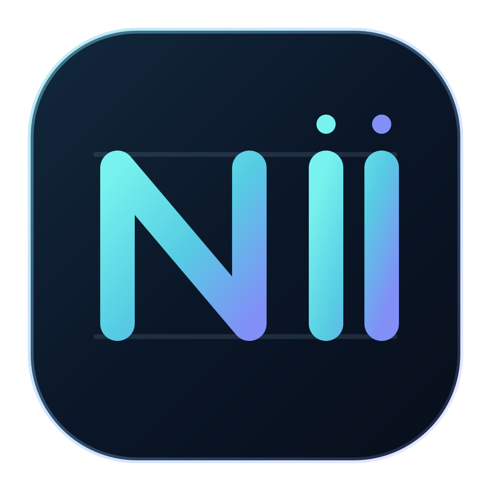

<div align="center">


<h1>Nullx11 Code</h1>
<p><strong>Powered by Free Claude Code</strong></p>

[](https://github.com/Inkflow-Gab/claude-code-cli/blob/main/LICENSE)
[](https://www.python.org/downloads/)
[](https://github.com/astral-sh/uv)
[](https://github.com/Inkflow-Gab/claude-code-cli/actions/workflows/tests.yml)
[](https://pypi.org/project/ty/)
[](https://github.com/astral-sh/ruff)
[](https://github.com/Delgan/loguru)

[Start here](#quick-start) · [Computer install](docs/install-desktop.md) · [Phone setup](docs/install-mobile.md) · [Agents](docs/agents.md) · [Providers](docs/providers.md) · [Integrations](#optional-integrations) · [Help](#troubleshooting)

</div>

## Quick Start

Nullx11 Code is the interface for Free Claude Code (FCC). It runs on a
**computer**, routes a coding agent to your chosen provider, and needs a
provider key or account. The install package remains `free-claude-code` and
commands remain `fcc-*` so existing setups still work. **Run one command at a
time.** Android on-device setup is experimental; the computer setup is the
reliable option.

<a id="install"></a>

### Linux (Ubuntu / Debian)

Run in a terminal on the computer:

```bash
sudo apt-get update
```

```bash
sudo apt-get install -y ca-certificates curl git make
```

```bash
git clone https://github.com/Inkflow-Gab/claude-code-cli.git
```

```bash
cd claude-code-cli
```

**Already cloned?** Refresh the existing checkout before running a newly added
installer option. First check for local edits:

```bash
git status --short
```

```bash
git branch --show-current
```

```bash
git remote get-url origin
```

The remote must be `https://github.com/Inkflow-Gab/claude-code-cli.git`
(or its SSH equivalent). If it points elsewhere, skip the pull and use the
fresh-installer fallback below instead. If status prints nothing and the branch
says `main`, update without creating a
merge commit. If the branch name is blank, you are detached (possibly from
older PR instructions); preserve your work before switching back to `main`.
If it shows a different branch, stop rather than updating the wrong branch:

```bash
git pull --ff-only origin main
```

If Git reports a conflict, a divergent branch, or local edits, **stop** and
preserve your changes before updating; do not force-reset the checkout. Confirm
that the refreshed script offers the guided option:

```bash
sh scripts/install.sh --help
```

If `--guided` is missing, you are still executing an old local script. The
installed package cannot change the script inside an old clone until you
update that clone. **If your checkout cannot fast-forward**, you can install
without altering it: download the current installer from this fork's `main`
to your home directory, review it, and only run it if the download succeeds:

```bash
curl -fL --retry 3 --output "$HOME/nullx-main-install.sh" "https://raw.githubusercontent.com/Inkflow-Gab/claude-code-cli/main/scripts/install.sh"
```

```bash
sh -n "$HOME/nullx-main-install.sh" && grep -q -- '--guided)' "$HOME/nullx-main-install.sh"
```

```bash
sh "$HOME/nullx-main-install.sh" --guided
```

The new `scripts/setup.sh` automates this safe download, syntax/feature check,
and temporary-file cleanup; once it is on `main`, you can use its copy in a
fresh checkout. Neither method rewrites your old Git checkout.

Run the **guided, all-in-one installer**. It asks you to choose one coding
agent, shows live steps and actual download progress, installs and checks
Nullx11 Code, then offers to start the server and open local Admin setup:

```bash
sh scripts/install.sh --guided
```

When asked, choose an agent (Enter selects Codex). Keep the first terminal
open if you start the server. On a computer, Admin normally opens at
`http://127.0.0.1:8082/admin`; there, add your own [provider](docs/providers.md)
key, pick a model, and click **Apply**. Credentials are never entered into the
installer. In a **second terminal**, from any project directory, run:

```bash
nullx
```

Choose **Coding agent CLI**, then your installed agent. You can still run
`fcc-codex` directly. For an unattended install, specify an agent; this
installs and verifies but does not launch a server:

```bash
sh scripts/install.sh --guided --agent codex
```

You can also use `make setup AGENT=codex`, `make check AGENT=codex`, and
`make run` separately. Developers testing a local, unmerged checkout can
pass `--from-checkout`; normal installs use the merged GitHub `main`.

[Full Linux instructions, curl alternative, and troubleshooting →](docs/install-desktop.md)

### Choose a mode with `nullx`

After installing the current Nullx11 Code build from this fork, run this
**from any directory**:

```bash
nullx
```

The hosted installer installs this fork's `main` branch. The checked-out
installer also uses `main` unless you explicitly pass `--from-checkout` to
build the local source. Refresh an older clone with `git pull --ff-only origin
main` first; installing a newer package does not update the clone's scripts.

Afterward, `nullx` runs from anywhere. Reopen your terminal after installation
if your updated uv tool PATH has not taken effect yet.

The menu offers **Telegram or Discord** (the existing bot workflow, using your
configured bot credentials), **coding-agent CLI** (launches an existing
`fcc-*` command), the local web dashboard, and the FCC server. Configure your
provider and model in Admin first. The messaging choice only applies to the
server launched by that menu; it does not overwrite saved settings. For CLI
coding agents, keep `fcc-server` running in a second terminal.

On startup, `nullx` checks GitHub `main` if it can identify the revision of
your installed build. It **asks twice** before installing a newer commit with
`uv`; declining leaves everything unchanged. If your installed package has no
Git revision, the menu still works but cannot reliably compare it with `main`.
Update checks are skipped in non-interactive mode. You can also use the
existing `fcc-*` commands directly.

The new [local welcome page](http://127.0.0.1:8082/admin/welcome) gives you
entry points for setup, code sessions, and messaging. The Admin dashboard
remains at `/admin` and is deliberately local-only; it cannot be opened from
another device without a trusted local-access arrangement.

### Windows (PowerShell)

Run this in PowerShell **on the Windows computer** (review the
[installer](scripts/install.ps1) first). Select **Codex** when prompted:

```powershell
& ([scriptblock]::Create((irm "https://raw.githubusercontent.com/Inkflow-Gab/claude-code-cli/main/scripts/install.ps1")))
```

Open a **new PowerShell window** and verify:

```powershell
fcc-server --version
```

Start FCC and leave this window open (or use the installed desktop app):

```powershell
fcc-server
```

Open the local Admin URL shown by the server, configure a
[provider](docs/providers.md), and click **Apply**. In another PowerShell
window, open your project directory and run:

```powershell
fcc-codex
```

[Full Windows instructions and troubleshooting →](docs/install-desktop.md#windows-powershell)

<a id="ubuntu-and-phone-setup"></a>

### Android phone: run FCC on the phone (experimental)

**Android 64-bit only; not verified on-device.** Open [Termux](https://termux.dev/)
(the official build, not an outdated Play Store copy). Run these **in Termux**:

```sh
pkg update
```

```sh
pkg install proot-distro
```

```sh
proot-distro install ubuntu
```

```sh
proot-distro login ubuntu
```

Now **inside Ubuntu in Termux** (not in Android's regular shell):

```sh
apt-get update
```

```sh
apt-get install -y ca-certificates curl git make
```

```sh
git clone https://github.com/Inkflow-Gab/claude-code-cli.git
```

```sh
cd claude-code-cli
```

**If you cloned `main` while reading open PR #4**, your checkout is older than
these commands. In that checkout, fetch the PR code **before installing**:

```sh
git fetch origin pull/4/head
```

```sh
git switch --detach FETCH_HEAD
```

Check that `sh scripts/install.sh --help` lists `--agent` and that
`scripts/check-setup.sh` exists. If you have local edits, save them before
switching; Git may refuse to switch otherwise. After PR #4 merges, a fresh
`main` clone no longer needs the fetch/switch steps.

```sh
sh scripts/install.sh --dry-run --agent codex
```

```sh
sh scripts/install.sh --agent codex
```

```sh
export PATH="$HOME/.local/bin:$HOME/.cargo/bin:$PATH"
```

```sh
sh scripts/check-setup.sh --agent codex
```

Start the server **inside Ubuntu**; keep Termux running:

```sh
HOST=127.0.0.1 fcc-server
```

Open `http://127.0.0.1:8082/admin` in your phone's browser, add a
[provider](docs/providers.md) and select a model. In a **second Ubuntu session**
(`proot-distro login ubuntu` in another Termux session), start Codex:

```sh
fcc-codex
```

If the Python/agent installer fails, stop: **Termux/proot is not a supported
platform**, and some ARM64 binaries may be unavailable. Do not install as
Android native Termux (without Ubuntu). See [Android caveats and fixes](docs/install-mobile.md#run-on-the-android-phone-experimental).

### iPhone or phone as a remote control (Telegram)

No on-device FCC installer is available for iPhone. Instead, complete the
Linux or Windows computer setup above and **keep that server running**. From
your phone, send `/newbot` to [@BotFather](https://t.me/BotFather), then `/start`
to [@userinfobot](https://t.me/userinfobot). On the **computer**, open local
Admin → **Messaging**: select `telegram`, enter your bot token and numeric
user ID, set **Allowed Directory** to a project folder, and click **Apply**.
Message your bot from the phone. Never expose Admin or port 8082 publicly.

[Complete remote-phone walkthrough (Telegram and Discord) →](docs/install-mobile.md#phone-as-a-remote-control)

### Other platforms and options

- [macOS, curl-based Linux install, headless Ubuntu, checks](docs/install-desktop.md)
- [Agents and launchers](docs/agents.md) · [Providers and models](docs/providers.md)
- [Phone troubleshooting](docs/install-mobile.md#if-your-bot-does-not-reply)

<a id="nvidia-nim-provider"></a>
<a id="3-configure-nvidia-nim"></a>

## Provider example: NVIDIA NIM

In local Admin, the **Connect your first model** guide links to official
provider key pages. Choose a provider, obtain and paste your own key, save it,
then open the model picker and click **Apply**. For example, get a key at
[NVIDIA NIM](https://build.nvidia.com/settings/api-keys) and enter it as
`NVIDIA_NIM_API_KEY`. Keys cannot be generated automatically by this app;
provider terms and free tiers are controlled by the provider.

## Troubleshooting

- Installer/command issue: [computer guide](docs/install-desktop.md#troubleshooting)
- Bot not responding: [mobile guide](docs/install-mobile.md#if-your-bot-does-not-reply)
- Diagnostic on the computer: `fcc-doctor` (review output before sharing)

## Choose A Provider

Choose a provider you have access to, add its credentials in local Admin,
select a tool-capable model, and click **Apply**. Free-tier availability,
quotas, and pricing are controlled by each provider, not by FCC. See the
**[provider and model reference](docs/providers.md)** for the full catalog,
local models, fallback behavior, and reasoning controls.

<a id="connect-your-client"></a>

## Connect Your Client

For editor and app integrations, install the client, start FCC, then open
**Admin UI → Integrations** and click **Connect** on its card.

- **Claude Code in VS Code**: Install the [Claude Code extension](https://marketplace.visualstudio.com/items?itemName=anthropic.claude-code).
- **VS Code Chat**: Install the latest [VS Code](https://code.visualstudio.com/), connect, and select an FCC model in its built-in Chat model picker.
- **Claude Desktop**: Install [Claude Desktop](https://claude.ai/download). Fully quit it before connecting or disconnecting, then reopen it. Disconnect returns to normal Claude sign-in.
- **Codex in VS Code and App**: Install the [Codex extension](https://marketplace.visualstudio.com/items?itemName=openai.chatgpt) or Codex App.
- **Claude Code in JetBrains ACP**: Install Claude Agent in JetBrains AI Assistant and start it once, then click **Connect** in FCC. Reopen the IDE, select **Claude Code (FCC)**, and start a new chat. After JetBrains updates the agent, restart FCC before starting a new chat. Requires a local IDE in its standard installation locations.

Reload VS Code or restart the app/IDE after connecting. In Codex and Claude Desktop, select an FCC
model from the model picker. Reload or restart the client when FCC reports updated settings. Use
**Disconnect** on the same card to remove the integration.

Run FCC on the same computer and in the same user environment as the client you
are configuring.

<a id="optional-integrations"></a>

## Optional Integrations

For Telegram or Discord setup, allowed IDs/directories, and chat commands,
follow the **[mobile setup guide](docs/install-mobile.md)**. Configure these
integrations from local **Admin UI → Messaging**, then click **Apply**.

<details>
<summary><strong>Voice notes</strong></summary>

NVIDIA NIM transcription support is included in every installation. In **Admin UI → Messaging → Voice**, enable voice notes, select `nvidia_nim`, and choose a supported model. Configure your **NVIDIA NIM API key** on the Providers page.

For local Whisper on CPU or CUDA, stop FCC and re-run the installer (from
the clone, or replace `scripts/install.sh` with your downloaded
`fcc-install.sh`). Use the same agent you installed previously:

```bash
sh scripts/install.sh --agent codex --voice-local
```

For an NVIDIA GPU with CUDA 13.0:

```bash
sh scripts/install.sh --agent codex --voice-local --torch-backend cu130
```

Windows PowerShell:

Local Whisper on CPU or CUDA:

```powershell
& ([scriptblock]::Create((irm "https://raw.githubusercontent.com/Inkflow-Gab/claude-code-cli/main/scripts/install.ps1"))) -VoiceLocal
```

Local Whisper with CUDA 13.0:

```powershell
& ([scriptblock]::Create((irm "https://raw.githubusercontent.com/Inkflow-Gab/claude-code-cli/main/scripts/install.ps1"))) -VoiceLocal -TorchBackend cu130
```

After installing local support, restart `fcc-server`. In **Admin UI → Messaging → Voice**, enable voice notes, select `cpu` or `cuda`, and choose the Whisper model. Local gated models need `HUGGINGFACE_API_KEY`.

</details>

## Manage Your Installation

Run `fcc-server --version` to check the installed version without starting FCC.

### Update

Stop all running FCC commands, then run:

```sh
fcc-update
```

If FCC is already up to date, the command stops without running the installer. Otherwise, it shows the installed and available versions before updating. If the version check fails, retry the command.

To reinstall FCC or change optional components while already up to date, run the [installer](#install) directly.

For local voice support, include `--voice-local` (macOS/Linux) or `-VoiceLocal` (Windows), plus your `--torch-backend` or `-TorchBackend` option if used.

If your installation does not have `fcc-update` yet, run the [installer](#install) once to add it.

### Muse Code on native Windows

To install or update only Muse Code:

```powershell
& ([scriptblock]::Create((irm "https://raw.githubusercontent.com/Inkflow-Gab/claude-code-cli/main/scripts/install-muse.ps1")))
```

To remove the Muse Code copy installed by FCC, keeping its data:

```powershell
& ([scriptblock]::Create((irm "https://raw.githubusercontent.com/Inkflow-Gab/claude-code-cli/main/scripts/uninstall-muse.ps1")))
```

Uninstalling FCC leaves Muse Code installed.

### Uninstall

Stop every running FCC command before uninstalling.

**Removes**

- The Free Claude Code package, including its desktop launcher and commands
- `~/.fcc/`

**Keeps**

- uv and Python
- Your coding agents and RTK

macOS/Linux (review the script before running; **this deletes** `~/.fcc/`):

```bash
curl -fL --progress-bar -o fcc-uninstall.sh "https://raw.githubusercontent.com/Inkflow-Gab/claude-code-cli/main/scripts/uninstall.sh"
```

If the download succeeded and you reviewed the file:

```bash
sh fcc-uninstall.sh
```

Windows PowerShell:

```powershell
& ([scriptblock]::Create((irm "https://raw.githubusercontent.com/Inkflow-Gab/claude-code-cli/main/scripts/uninstall.ps1")))
```

## Project Links

For a problem after installation, run the command below and paste its output into your bug report. It also copies the JSON to your clipboard when available.

```bash
fcc-doctor
```

- [Report bugs or request features](https://github.com/Inkflow-Gab/claude-code-cli/issues)
- [Contributing guide](CONTRIBUTING.md)

## Credits

This repository is a maintained copy of **Free Claude Code**, an independent
open-source project. All credit for the original project goes to its real owner
and repository:

- **Real owner:** [Alishahryar1](https://github.com/Alishahryar1)
- **Real repository:** [Alishahryar1/free-claude-code](https://github.com/Alishahryar1/free-claude-code)
- **Original installer:**

  ```bash
  curl -fsSL "https://raw.githubusercontent.com/Alishahryar1/free-claude-code/main/scripts/install.sh" | sh
  ```

This copy is published under the same `AGPL-3.0-only` license as the original.

## License

GNU Affero General Public License version 3 only (`AGPL-3.0-only`). See [LICENSE](LICENSE) for details.
